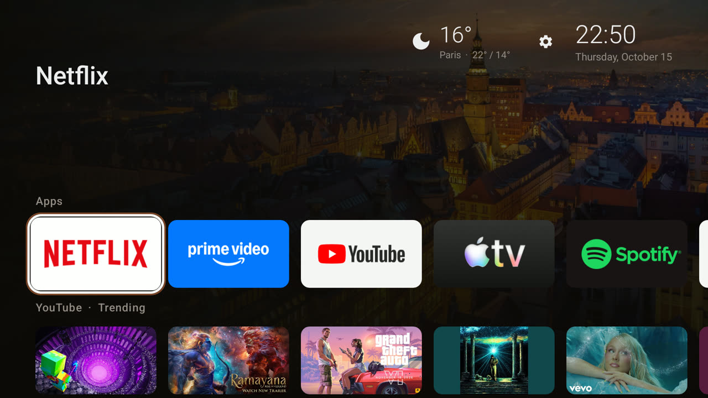
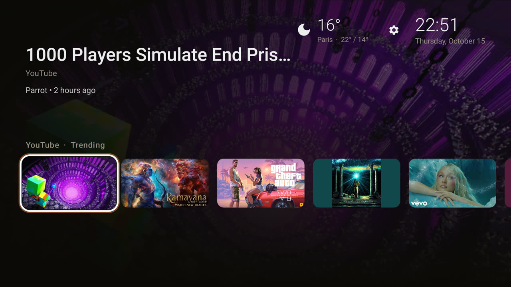
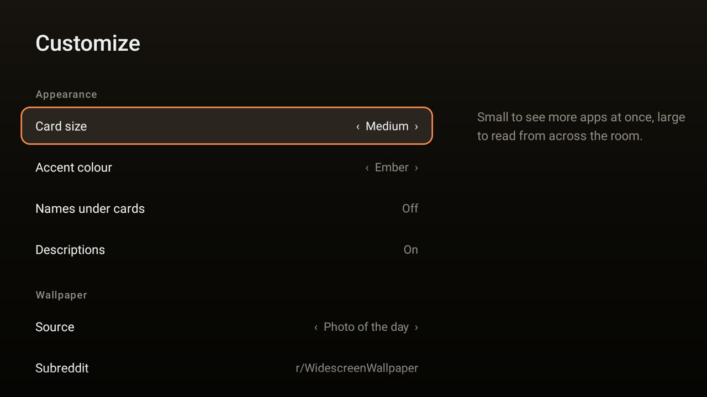

  

<h1 align="center">Couch</h1>

  
  
  
  
  

A light, fast home screen for Android TV, built for TVs whose chips struggle with the stock
launcher. Plain Android Views, no AndroidX, no Compose, no tracking, and an APK under 200 KB.

  
  
  

## Why

- **Smooth on weak hardware.** On a 2020 MediaTek-based TV, Couch renders frames in
  10 / 13 / 14 ms (p50 / p90 / p99) where a popular third-party launcher needs 14 / 25 / 31 ms
  for the same remote presses. Focus only animates render properties, rows glide by translation,
  and every bitmap is decoded at the exact size it is drawn.
- **Nothing you didn't ask for.** No ads, no sponsored rows, no analytics. The network is only
  used for the features you turn on (wallpaper, weather, app artwork).
- **Yours to arrange.** Every row, app, input and colour can be changed from the remote.

## Features

- Hero area showing the focused show or film: backdrop, title, episode, time left, synopsis.
- Apps row, HDMI inputs row with brand logos (PlayStation, Xbox, Nintendo Switch, Apple TV…),
  and the preview channels apps publish (YouTube, Jellyfin and others).
- Wallpaper: Bing photo of the day, the best images of a subreddit, a gradient, or your own.
- Weather (Open-Meteo, located automatically or by city), clock, now playing.
- Ambient mode after a few idle minutes: full-screen wallpaper, large clock, weather.
- Long-press any card to move, rename, hide or change its icon.
- **Customize**: card size, accent colour, dimming, names under cards, row order and
  visibility, app channels, inputs, clock format, weather, ambient delay.
- HOME button takeover on TVs that hardwire HOME to the stock launcher, repairing itself if
  Android drops it.

The interface is in English, or French on a TV set to French.

## Install

On the TV: install **Downloader** from the Play Store, open it and enter `samlo.cloud/couch.apk`.
It always fetches the [latest release](https://github.com/samuelloranger/couch/releases/latest).

Then turn on **Couch: Home button** in the TV's accessibility settings so HOME opens Couch.
The [setup guide](https://samlo.cloud/couch/setup) covers installing from a computer and the
optional ADB permissions.

## Documentation

The full documentation is at **[samlo.cloud/couch](https://samlo.cloud/couch)**. The same pages live in [`docs/`](docs):

- [Setup](docs/setup.md): install, permissions, HOME button, updating.
- [Configuration](docs/configuration.md): every option, `config.json`, custom icons and wallpaper.
- [Architecture](docs/architecture.md): how the code is organised and why it stays fast.
- [Development](docs/development.md): building, the TV emulator, tests, releases.
- [Decisions](docs/decisions.md): the trade-offs behind the less obvious choices.

## Credits

Brand marks from [Simple Icons](https://simpleicons.org) (CC0) and Wikimedia Commons (public
domain). All trademarks belong to their owners. Weather by [Open-Meteo](https://open-meteo.com),
IP location by [ipwho.is](https://ipwho.is), subreddit images through the
[Arctic Shift](https://github.com/ArthurHeitmann/arctic_shift) archive.
